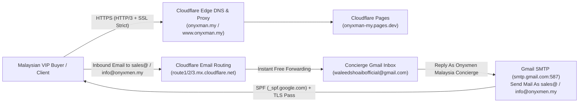

# Onyxmen.my — Cloudflare DNS, Custom Domain & 100% Free Business Email Runbook

**Micro-Steps Covered:** `MS-181` to `MS-185`  
**Primary Domain:** `onyxman.my` (`www.onyxman.my`)  
**Cloudflare Pages Target:** `onyxman-my.pages.dev`  
**Business Email Addresses (`RM 0 / Free Forever`):**
- `sales@onyxmen.my` → forwards instantly to `waleedshoaibofficial@gmail.com`
- `info@onyxmen.my` → forwards instantly to `waleedshoaibofficial@gmail.com`
- `*@onyxman.my` (Catch-All) → forwards instantly to `waleedshoaibofficial@gmail.com`

---

## Architecture Overview



> [!IMPORTANT]
> **Why Merged SPF Matters (`MS-181`):** By default, Cloudflare Email Routing creates an SPF record containing only `include:_spf.mx.cloudflare.net`. When you reply from Gmail using **"Send Mail As"** (`smtp.gmail.com`), recipient mail servers verify whether Google's outbound servers are authorized to send on behalf of `onyxman.my`. Our merged SPF record (`v=spf1 include:_spf.mx.cloudflare.net include:_spf.google.com ~all`) authorizes **both** Cloudflare inbound forwarding and Gmail outbound SMTP so 100% of your replies land in the primary inbox.

---

## Step 1: Replace Namecheap BasicDNS with Cloudflare Assigned Nameservers (`onyxman.my`)

### 1.1 Add `onyxman.my` to Cloudflare
1. Log in to the [Cloudflare Dashboard](https://dash.cloudflare.com/) and click **Add a domain**.
2. Enter `onyxman.my`, select the **Free (`RM 0/month`)** plan, and click **Continue**.
3. On the **Review your DNS records** screen, you can either:
   - **Option A (1-Click BIND File Import):** Click **Import DNS records** and upload [`config/cloudflare-dns-records.bind`](../config/cloudflare-dns-records.bind), OR
   - **Option B (Automated API Script):** Run `node scripts/cloudflare-dns-email-setup.mjs` with your `CLOUDFLARE_API_TOKEN` and `CLOUDFLARE_ZONE_ID`.
4. Copy the **2 Cloudflare Assigned Nameservers** displayed at the bottom of the screen (for example, `xxxx.ns.cloudflare.com` and `yyyy.ns.cloudflare.com`).

### 1.2 Update Nameservers in Namecheap (or `.my` Registrar)
1. Log in to your **Namecheap Dashboard** → **Domain List** → click **Manage** next to `onyxman.my`.
2. Locate the **Nameservers** section.
3. Change the dropdown from **Namecheap BasicDNS** (or Web Hosting DNS) to **Custom DNS**.
4. Paste the two Cloudflare nameservers into **Nameserver 1** and **Nameserver 2**:
   - `Nameserver 1`: `<your-assigned-ns1>.ns.cloudflare.com`
   - `Nameserver 2`: `<your-assigned-ns2>.ns.cloudflare.com`
5. Click the **Green Checkmark (`✓`)** to save.
6. Return to Cloudflare and click **Check nameservers now**. Malaysian `.my` registry (MYNIC) and Namecheap propagation typically completes within **5 to 30 minutes**.

### 1.3 Link Custom Domains to Cloudflare Pages (`onyxman-my`)
1. In Cloudflare Dashboard, go to **Workers & Pages** → select **`onyxman-my`** → **Custom domains** tab.
2. Click **Set up a custom domain** → enter `onyxman.my` → click **Activate domain**.
3. Repeat for `www.onyxman.my`.
4. Verify that **SSL/TLS** → **Overview** is set to **Full (strict)** and **SSL/TLS** → **Edge Certificates** → **Always Use HTTPS** is enabled.

---

## Step 2: 1-Click Cloudflare Email Routing Activation (`RM 0 / Free Forever`)

This routes all emails sent to `sales@onyxmen.my`, `info@onyxmen.my`, and any other `@onyxman.my` address directly into `waleedshoaibofficial@gmail.com` at zero monthly cost.

### 2.1 Verify Destination Address (`waleedshoaibofficial@gmail.com`)
1. In the Cloudflare Dashboard, select **`onyxman.my`** → navigate to **Email** → **Email Routing** in the left sidebar.
2. Go to the **Destination addresses** tab and click **Add destination address**.
3. Enter:
   ```text
   waleedshoaibofficial@gmail.com
   ```
4. Click **Save**. Cloudflare immediately sends a verification email to `waleedshoaibofficial@gmail.com` with subject *"Verify your email address for Cloudflare Email Routing"*.
5. Open `waleedshoaibofficial@gmail.com` and click **Verify email address**. The status in Cloudflare will turn **Verified (Green)**.

### 2.2 Create Custom Routing Rules (`sales@` & `info@`) and Enable Catch-All
1. Go to **Email** → **Email Routing** → **Routing rules** tab.
2. Click **Create address** and add **Rule #1 (VIP Concierge & Sales)**:
   - **Custom address:** `sales` (`@onyxman.my`)
   - **Action:** `Send to an email`
   - **Destination:** `waleedshoaibofficial@gmail.com`
   - Click **Save**.
3. Click **Create address** and add **Rule #2 (General & Order Inquiries)**:
   - **Custom address:** `info` (`@onyxman.my`)
   - **Action:** `Send to an email`
   - **Destination:** `waleedshoaibofficial@gmail.com`
   - Click **Save**.
4. Under **Catch-all address**, toggle the switch to **Active**, click **Edit**, set **Action** to `Send to an email` → `waleedshoaibofficial@gmail.com`, and click **Save**.

### 2.3 Confirm Merged SPF Record in Cloudflare DNS
1. Go to **DNS** → **Records** in Cloudflare.
2. Locate the `TXT` record for `onyxman.my` starting with `v=spf1` and confirm it matches our merged string:
   ```text
   v=spf1 include:_spf.mx.cloudflare.net include:_spf.google.com ~all
   ```
3. Confirm the `_dmarc` `TXT` record is present:
   ```text
   v=DMARC1; p=quarantine; rua=mailto:waleedshoaibofficial@gmail.com; pct=100; adkim=r; aspf=r
   ```

---

## Step 3: Configure Gmail "Send Mail As" (`sales@onyxmen.my` & `info@onyxmen.my`)

With inbound forwarding active, this step configures your `waleedshoaibofficial@gmail.com` account so you can compose and reply to customers directly from **`Onyxmen Malaysia Concierge <sales@onyxmen.my>`** and **`Onyxmen Malaysia Apothecary <info@onyxmen.my>`** for free.

### 3.1 Generate a 16-Character Google App Password
1. Log in to `waleedshoaibofficial@gmail.com` and open [Google Account Security](https://myaccount.google.com/security).
2. Ensure **2-Step Verification** is turned **ON**.
3. Go directly to [Google App Passwords](https://myaccount.google.com/apppasswords).
4. Under **App name**, type:
   ```text
   Onyxmen.my Outbound SMTP
   ```
5. Click **Create**.
6. Copy the **16-character App Password** shown in the yellow box (remove spaces when pasting, e.g. `abcd efgh ijkl mnop` → `abcdefghijklmnop`). Keep this window open for Step 3.2.

### 3.2 Add `sales@onyxmen.my` in Gmail Settings
1. Open [Gmail](https://mail.google.com/) while signed in to `waleedshoaibofficial@gmail.com`.
2. Click the **Gear icon (`⚙️`)** (top right) → **See all settings** → **Accounts and Import** tab.
3. In the **Send mail as** section, click **Add another email address**.
4. In the popup window, enter:
   - **Name:** `Onyxmen Malaysia Concierge`
   - **Email address:** `sales@onyxmen.my`
   - **Treat as an alias:** Checked (`✓`)
   - Click **Next Step >>**.
5. Enter the exact **SMTP Server Configuration**:
   | Field | Exact Value |
   | :--- | :--- |
   | **SMTP Server** | `smtp.gmail.com` |
   | **Port** | `587` |
   | **Username** | `waleedshoaibofficial@gmail.com` |
   | **Password** | *(Paste the 16-character Google App Password from Step 3.1)* |
   | **Secured connection** | **Secured connection using TLS** *(recommended)* |
6. Click **Add Account**.
7. Because `sales@onyxmen.my` already forwards to `waleedshoaibofficial@gmail.com` via Step 2, the Gmail verification code email will arrive inside your `waleedshoaibofficial@gmail.com` inbox within 5 seconds.
8. Open that email, click the confirmation link (or paste the confirmation code into the popup), and click **Verify**.

### 3.3 Add `info@onyxmen.my` in Gmail Settings
1. Still under **Settings** → **Accounts and Import** → **Send mail as**, click **Add another email address** a second time.
2. Enter:
   - **Name:** `Onyxmen Malaysia Apothecary`
   - **Email address:** `info@onyxmen.my`
   - **Treat as an alias:** Checked (`✓`)
   - Click **Next Step >>**.
3. Enter the same **SMTP Server Configuration** (`smtp.gmail.com`, Port `587`, Username `waleedshoaibofficial@gmail.com`, and the same 16-character Google App Password, TLS).
4. Click **Add Account** and click the verification link that arrives in `waleedshoaibofficial@gmail.com`.

### 3.4 Enable Automatic "Reply from the same address"
1. Under **Settings** → **Accounts and Import** → **Send mail as**, find the option **"When replying to a message:"**.
2. Select **"Reply from the same address the message was sent to"**.
3. Now, whenever a customer emails `sales@onyxmen.my` or `info@onyxmen.my`, hitting **Reply** in Gmail automatically sends from `sales@onyxmen.my` or `info@onyxmen.my`!

---

## Step 4: Automated CLI Verification & Live Execution (`MS-182` / `MS-183`)

### Dry-Run Verification (No Credentials Needed)
Validates the RFC 1035 BIND zone file (`config/cloudflare-dns-records.bind`), DNS schemas, SSL/Edge performance payloads, and Email Routing rules:
```bash
node scripts/cloudflare-dns-email-setup.mjs --dry-run
```

### Live Cloudflare API v4 Provisioning
Once your Cloudflare API Token (`Zone:DNS:Edit`, `Zone:Zone Settings:Edit`, `Zone:Email Routing Rules:Edit`, `Account:Email Routing Addresses:Edit`, `Account:Cloudflare Pages:Edit`) is ready:
```bash
CLOUDFLARE_API_TOKEN="your_token" \
CLOUDFLARE_ZONE_ID="your_zone_id" \
CLOUDFLARE_ACCOUNT_ID="your_account_id" \
node scripts/cloudflare-dns-email-setup.mjs
```
